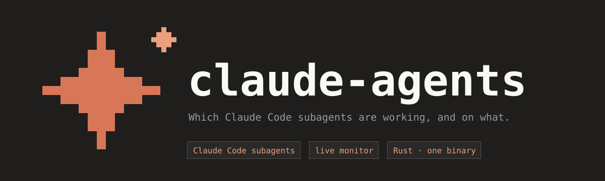
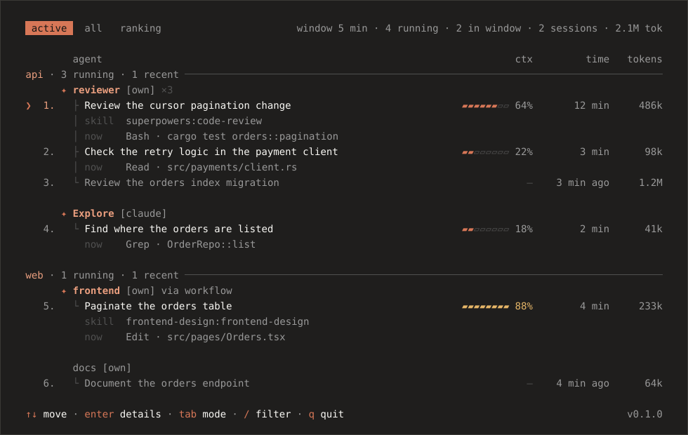

<p align="center">
  
</p>

<p align="center">
  <a href="#install"></a>
  <a href="LICENSE"></a>
  <a href="https://github.com/towerforge/claude-agents/releases"></a>
  
</p>

<p align="center">
  Lists the Claude Code subagents on disk and shows which ones are running, what they were asked to do, how long they worked and the tokens they used.
</p>

<p align="center">
  
</p>

## Install

macOS and Linux:

```sh
curl -fsSL https://raw.githubusercontent.com/towerforge/claude-agents/main/install.sh | sh
claude-agents
```

No configuration: it looks for agents under your home directory (`~/.claude/agents/*.md` and every `<project>/.claude/agents/*.md`) and reads the transcripts in `~/.claude/projects/`.

<details>
<summary><b>Installer options, manual download, from source, updating</b></summary>

[`install.sh`](install.sh) downloads the archive for your OS and architecture from the latest release, checks its SHA-256 against `checksums.txt` (a missing checksum warns, a mismatch stops it) and asks for `Enter` before installing. It needs `curl` and `tar`, and paints with the same palette as the screen. It is for the first install: if it finds a `claude-agents` that can update itself (in the install directory or on your `PATH`), it points you to `claude-agents update` and installs nothing, unless `CLAUDE_AGENTS_FORCE=1`.

| Variable | Effect | Default |
|---|---|---|
| `CLAUDE_AGENTS_VERSION` | Installs that version (`0.2.0` or `v0.2.0`) | the latest release |
| `CLAUDE_AGENTS_INSTALL_DIR` | Directory to install into | `~/.local/bin`, or `/usr/local/bin` as root |
| `CLAUDE_AGENTS_VARIANT` | `musl` (static, no glibc) or `gnu`. Linux only | `musl` if `ldd` reports musl, `gnu` otherwise |
| `CLAUDE_AGENTS_FORCE` | Any value installs even over a `claude-agents` that can update itself | |
| `NO_COLOR` | No colors in the installer's output | |

**Manual download:** the [releases page](https://github.com/towerforge/claude-agents/releases/latest) has archives for Linux x86_64 and ARM64 (glibc and musl) and macOS Intel and Apple Silicon; see [docs/releases.md](docs/releases.md#archives). No Windows build: use WSL.

**From source** (Rust 1.88 or newer): `cargo install --git https://github.com/towerforge/claude-agents`.

**Updating:** `claude-agents update`; see [Updating](#updating). A copy from before `claude-agents update` existed is upgraded by running the installer again.

</details>

## Features

- **Global and project agents**, grouped by project; a project agent only matches sessions launched inside its project, even if the main agent later did a `cd` elsewhere.
- **Live monitor** of what is running and what finished within the window: task, current tool, context, tokens and time. Refreshes every 2 s.
- **Claude Code's own agents and workflow steps** too, labeled `[claude]` and `[workflow]` next to your `[own]` ones.
- **Time worked per day**, without pauses over 5 minutes.
- **Tokens and context** per run, with the model.
- **Who launched each run**: the session and its first prompt, or another run.
- **Ranking** by time, tokens or runs over 7 days, 30 days or all time.
- **Kept history**: finished runs survive Claude Code's transcript cleanup.
- **`--plain`** prints a table and exits; so does piping.
- **Updates itself** with `claude-agents update`, and the screen says when a new release is out.

## Using claude-agents

Three views, as tabs in the header:

- **active** (default): one block per agent and project with `task`, `now`/`last` and the subagent's `cwd`; running ones first, marked `✦`. Groups go by the folder where the Claude Code session was launched.
- **all**: every agent on disk by project, with a 14-day bar, time worked, runs and last use.
- **ranking**: agents with work in the period, from most to least.

`Enter` opens the agent's details (in all and ranking) or the run's (in active). The mouse works too: the wheel scrolls, a click on a tab switches view, a click on a row selects it and a second click on it opens it like `Enter`. Every view in detail: [docs/interface.md](docs/interface.md); all the keys: [keys and formats](docs/interface.md#keys-and-formats).

### Flags

```sh
claude-agents                       # interactive screen, 10 min window, whole home
claude-agents -m 60                 # last hour
claude-agents -r ~/code -r ~/work   # narrows the search
claude-agents -p -v                 # the table, plus the open sessions with pid and command
```

| Flag | Meaning | Default |
|---|---|---|
| `-r`, `--root <DIR>` | Directories to search for `.claude/agents/*.md` (repeatable). `~/.claude/agents` is always added | the home directory |
| `-m`, `--minutes <N>` | Window in minutes: an agent is active if it was used within it or has a run in progress | `10` |
| `-v`, `--verbose` | Also shows open Claude sessions, with pid and command (only with `--plain`) | |
| `-p`, `--plain` | Prints the table and exits, instead of opening the interactive screen. This also happens when the output is not a terminal | |
| `-V`, `--version` | Prints the version and exits | |

### `--plain`

```
STATE     NAME      LAST USED     WORKED  PATH
RUNNING   reviewer  2 min ago  1 h 4 min  ~/code/shop/api/.claude/agents/reviewer.md
ACTIVE    backend   6 min ago     35 min  ~/code/shop/api/.claude/agents/backend.md
inactive  docs      3 d ago        4 min  ~/code/shop/web/.claude/agents/docs.md

3 agents, 2 active (window: 10 min). Open Claude sessions: 2
```

Details: [docs/interface.md](docs/interface.md#the---plain-table).

## Updating

```sh
claude-agents update            # what the new release brings, and it installs it once you say yes
claude-agents update --check    # says what there is and installs nothing
```

It downloads the archive for your OS and architecture from the GitHub release, checks its SHA-256 against `checksums.txt` (a mismatch stops it and leaves the old binary; if the release has no checksum it installs and says `not verified`) and swaps the running binary in place.

| Flag | Meaning |
|---|---|
| `--check` | Says what there is and installs nothing |
| `-y`, `--yes` | Installs without asking |
| `--force` | Installs over a `cargo install` or a build under `target/`, and reinstalls the version you already have |
| `--to <VERSION>` | That version instead of the latest one (`1.0.0` or `v1.0.0`), downgrades included |

In a terminal it opens a small panel below the prompt: the current and new version, the package, where it installs and what is new, then a question, the download bar and the result; `esc`, `q` or `n` cancel before anything is touched. Without a terminal it prints a few lines and needs `--yes` to install. A binary from `cargo install` or a local build is left alone, and it says what updates it instead. Where you cannot write, run it with `sudo`, or set `CLAUDE_AGENTS_INSTALL_DIR` and use `install.sh`. It exits with 1 only if something fails; a new release found by `--check` is not a failure.

The screen asks GitHub in the background at most once a day and, if there is something newer, says so in the footer: `↑ v1.2.0 available · claude-agents update`. `CLAUDE_AGENTS_NO_UPDATE_CHECK=1` turns that check off. Details: [docs/how-it-works.md](docs/how-it-works.md#updating) and [docs/interface.md](docs/interface.md#the-update-panel).

## How it works

It only reads Claude Code's files, plus `ps` for open sessions; the network is only for [updates](#updating):

- [Active](docs/how-it-works.md#how-it-decides-an-agent-is-active): an `Agent` call within the window, or a run in progress.
- [Time worked](docs/how-it-works.md#how-worked-time-is-calculated): gaps between transcript lines, minus pauses over 5 minutes.
- [Tokens and context](docs/how-it-works.md#tokens-and-context): from `message.usage`.
- [Who launched whom](docs/how-it-works.md#who-launched-whom): the meta's `toolUseId`.
- [Launch folder](docs/how-it-works.md#launch-folder): the first real `cwd` of the session's main transcript; it decides the group and which project agents match.
- [Kept history](docs/how-it-works.md#kept-history): `~/.cache/claude-agents/runs.jsonl`.
- [Updates and network](docs/how-it-works.md#updating): `api.github.com`, once a day from the screen and on `claude-agents update`; the date of the last check goes in `~/.cache/claude-agents/update-check.json`. Those two files, and its own binary on `update`, are all it writes.

Limitations: [docs/how-it-works.md](docs/how-it-works.md#limitations).

## FAQ

**A run shows as finished but it is still working.** A run that writes nothing for 10 minutes (a pending permission, a long tool) shows as interrupted until it writes again; a workflow step, after 2 minutes.

**Why don't `general-purpose` or `Explore` show in all or in the ranking?** They have no definition on disk. They show in active, but add no time to any agent.

**An agent I used shows as `never`.** Old `Agent` calls are not kept once Claude Code deletes their transcripts; only runs are.

**How do I keep it off the network?** Set `CLAUDE_AGENTS_NO_UPDATE_CHECK=1` and do not run `claude-agents update`; `--plain` never checks. Without a connection the screen just shows no notice.

**I cannot select text with the mouse.** The screen captures the mouse for the wheel and clicks. Hold `Shift` while dragging (`Option` in iTerm2).

## Contributing

Open pull requests against `beta`, with `make check` green.

## License

[MIT](LICENSE)

<p align="center">
  <br>
  
</p>
